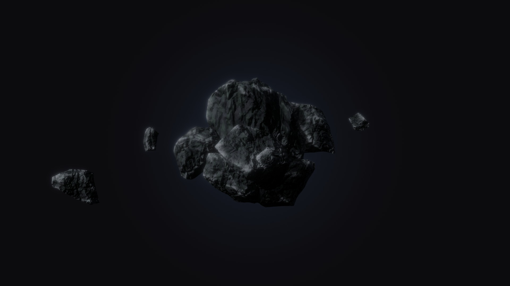

# Rock Demo

A small WebGPU experiment built with Three.js: a rock spins in a dark studio, smaller rocks fall on it and stick, and a few pebbles stay in orbit around the whole thing.



## What happens

1. The main rock spins on its own.
2. After five seconds, eight rocks fly in from every direction, hit it and stay attached. Each hit knocks the rock slightly off its place before it settles back.
3. Once they have settled, four pebbles spiral in and keep orbiting. They push each other aside if their paths cross.

## Controls

- **Drag** to orbit the camera, **scroll** to zoom.
- **Move the pointer** over the rocks to nudge them.
- The **Controls** panel changes how the rocks fall (gravity, damping, grip, bounce, friction) and how the pebbles orbit (speed, gap, band). **Launch** plays the sequence again.
- Add `#debug` to the URL to swap that panel for the full development one.

## Run it

```bash
npm install
npm run dev
```

Then open http://localhost:5173. To build for production:

```bash
npm run build
npm run preview
```

It needs a browser with WebGPU. Three.js falls back to WebGL 2 on its own when WebGPU is missing, but that path has not been tested here.

## Built with

- [Three.js](https://threejs.org/) r186: `WebGPURenderer`, with post-processing written in TSL (bloom, FXAA, dithered backdrop).
- [Rapier](https://rapier.rs/) for the physics: a convex hull per rock and the real triangles of the main one.
- [Vite](https://vite.dev/).

The rocks were modelled in Blender and exported as GLB, compressed with meshopt and with their textures embedded as WebP.

## Project layout

```
index.html              canvas, title and link
src/style.css           page and panel styles
src/Experience/         camera, renderer, post-processing, physics
src/Experience/World/   the rocks: Rock, Fragments, Orbiters
src/Experience/Utils/   sizes, time, resources, pointer, panels
public/models/          the GLB files
```
